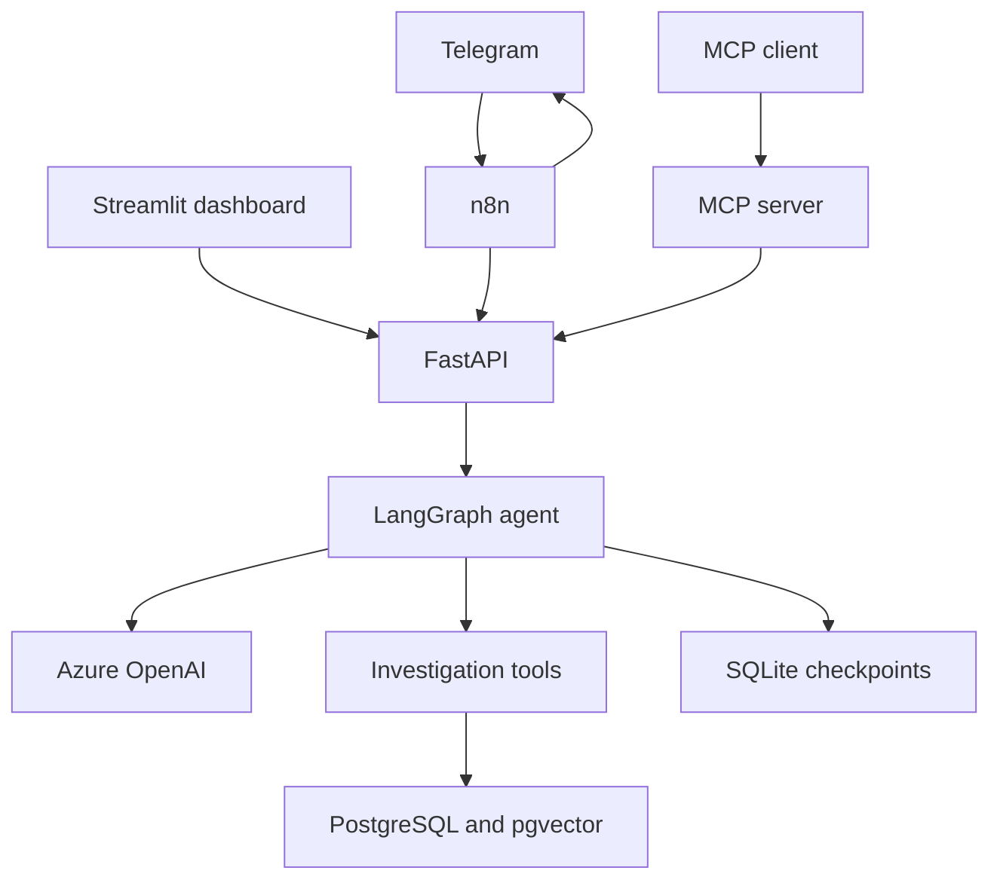
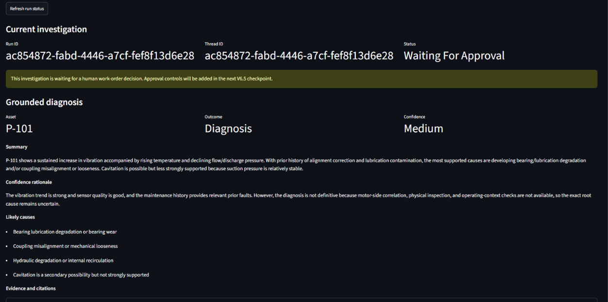
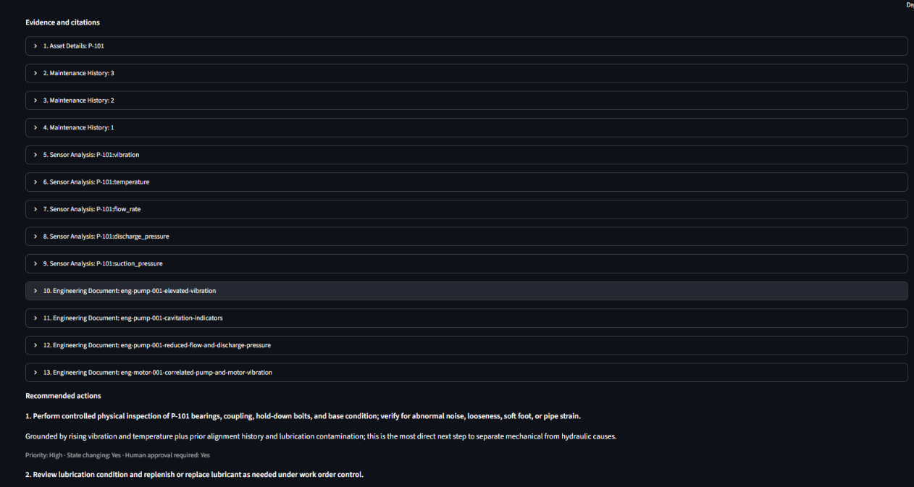
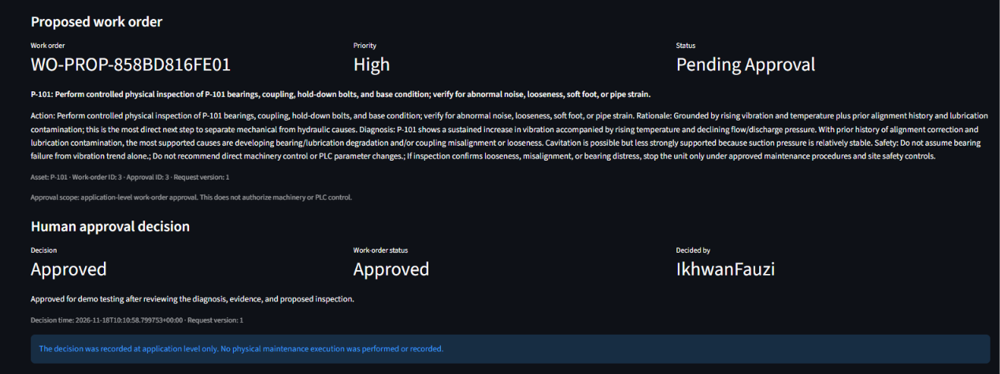
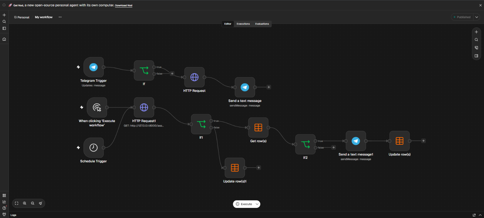
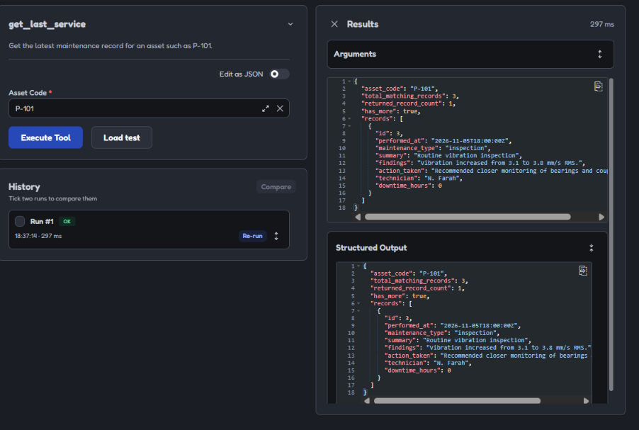

# Agentic GenAI Maintenance Copilot

An evidence-grounded maintenance investigation assistant for rotating equipment.

The application combines asset information, maintenance history, sensor analysis, and engineering documents to investigate equipment issues. It proposes a work order when appropriate and requires an explicit human approval or rejection decision.

The current local stack uses PostgreSQL for application records and pgvector for engineering-document retrieval, with FastAPI, LangGraph, Azure OpenAI, and a Streamlit dashboard.

## Demonstrated capabilities

- Investigate pump and motor issues using four investigation tools.
- Present a grounded diagnosis with evidence, citations, and uncertainty.
- Propose work orders and record human approval decisions.
- Retrieve engineering-document chunks using pgvector.
- Answer supported maintenance-history requests through Telegram and n8n.
- Send temperature alerts with stored state to suppress repeated notifications.
- Provide a Telegram button that opens the dashboard.
- Expose maintenance-history lookup through an MCP server.

This is a portfolio demonstration using synthetic industrial records and a small engineering-document corpus.

## Architecture



PostgreSQL stores application records and document vectors. LangGraph checkpoints remain in a separate SQLite database.

The MCP integration currently exposes maintenance-history lookup. The n8n workflow calls the API for maintenance-history replies and temperature alerts.

## Technology

| Component | Implementation |
|---|---|
| API | FastAPI |
| Agent workflow | LangGraph |
| Language model | Azure OpenAI |
| Application database | PostgreSQL 17 |
| Vector retrieval | pgvector |
| Embeddings | `sentence-transformers/all-MiniLM-L6-v2` |
| Database access and migrations | SQLAlchemy, Psycopg, Alembic |
| Dashboard | Streamlit |
| Automation | n8n and Telegram |
| Tool integration | MCP |
| Local deployment | Docker Compose |
| Quality checks | Ruff and pytest |

The engineering-document collection currently contains three source documents and nine chunks with 384-dimensional embeddings.

## Local setup

Prerequisites:

- Docker Desktop running with Linux containers.
- An `.env` file with valid model-provider credentials.
- Available ports `5432`, `8000`, and `8501`.

For a new checkout, create the environment file:

```cmd
copy .env.example .env
```

Edit `.env` before starting. Replace the example database password and configure the selected model provider.

For local Python commands, `DATABASE_URL` must use the same PostgreSQL credentials as Docker Compose. Inside the API container, Compose supplies the database hostname `postgres`.

Do not overwrite an existing `.env` containing your credentials.

For a fresh database:

```cmd
docker compose up -d --build --wait --wait-timeout 600
docker compose ps
```

Open:

- Dashboard: http://localhost:8501
- API documentation: http://127.0.0.1:8000/docs
- Health endpoint: http://127.0.0.1:8000/health

The dashboard container connects to the API through `http://api:8000`.

**Existing databases:** the current seed validator expects the original demonstration row counts. After creating additional work orders or approvals, set the API service's `INITIALIZE_APPLICATION_DATA` to `"false"` before recreating it. See the [demo guide](docs/demo-guide.md) for the procedure.

The Docker API uses port `8000`; stop any separately running local Uvicorn process using that port.

## Example investigation

Enter this request in the dashboard:

> Investigate increasing vibration on P-101. Gather asset details, maintenance history, sensor analysis, and engineering guidance before giving a grounded assessment.

Review the diagnosis, evidence, citations, and proposed work order before submitting a human decision.

Model responses can vary. A successful investigation should ground its conclusions in retrieved evidence and explain material uncertainty.

### Grounded diagnosis



### Evidence and citations



### Human approval



Approval records an application-level work-order decision. It does not execute physical maintenance or control equipment.

## Telegram and MCP integrations

The n8n workflow supports maintenance-history replies and a temperature-alert demonstration.

The alert workflow stores whether the asset was already above the threshold. This allows a subsequent check to suppress a repeated alert while the recorded condition remains high.



Telegram alerts include a dashboard link. For a phone demonstration, use a reachable laptop address on the current network; `localhost` on the phone refers to the phone itself.

The MCP server exposes `get_last_service`, which retrieves maintenance history through the API.



See [integration setup and behavior](docs/integrations.md) for configuration, alert state, and limitations.

## Validation

The local validation run passed **536 tests**, including five PostgreSQL integration tests enabled with `RUN_POSTGRES_TESTS=1`.

Validation also included:

- A healthy local PostgreSQL, API, and dashboard Compose stack.
- Successful maintenance-history and temperature API responses.
- A live model investigation with engineering-document citations.
- A human approval decision verified in PostgreSQL.
- Telegram maintenance-history lookup after the database migration.
- MCP maintenance-history lookup after the database migration.

The alert screenshots document the earlier alert demonstration. They are retained separately from the post-migration lookup checks.

Run the standard checks with the development dependencies installed:

```cmd
python -m ruff format --check .
python -m ruff check .
python -m pytest -q
```

The five PostgreSQL integration tests require a separate test database and an explicit opt-in. See [PostgreSQL and pgvector](docs/postgresql-pgvector.md).

GitHub Actions runs quality checks, infrastructure compilation, and a container health smoke test. The local PostgreSQL integration results above do not imply that those tests run in CI.

## Documentation

| Guide | Contents |
|---|---|
| [Demo guide](docs/demo-guide.md) | Startup, investigation, approval, integrations, screenshots, and shutdown |
| [Integrations](docs/integrations.md) | Telegram, n8n, alert suppression, and MCP |
| [PostgreSQL and pgvector](docs/postgresql-pgvector.md) | Migration, vector storage, retrieval, and integration tests |
| [Development history](docs/development-history.md) | Earlier implementation stages and historical Azure deployment |

## Scope and current limitations

- The data and document corpus are small, synthetic demonstration fixtures.
- Temperature readings are historical; the alert flow does not check reading freshness.
- Alert suppression is state-based and does not guarantee exactly-once delivery under concurrent executions.
- Vector retrieval uses exact search; no approximate nearest-neighbor index is configured.
- The current seed validator requires the existing-database startup workaround described above.
- The proposed-work-order panel can retain a stale pending label after approval; the decision panel and database record show the recorded decision.
- LangGraph checkpoints remain SQLite-backed.
- The updated PostgreSQL stack was validated locally. The earlier Azure deployment screenshots document the previous deployment, not a new PostgreSQL deployment.

The copilot does not control machinery, modify PLC parameters, bypass interlocks, or perform physical maintenance.

## Historical hosted demonstration

An earlier version was deployed to Azure Container Apps. Its screenshots remain available in the [development history](docs/development-history.md).

They provide historical deployment evidence and should be read alongside the current local-stack documentation.