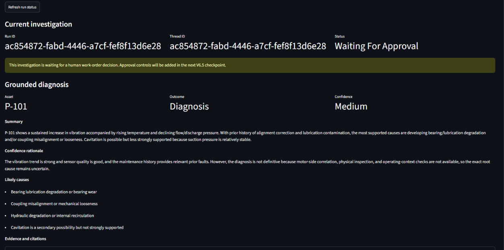
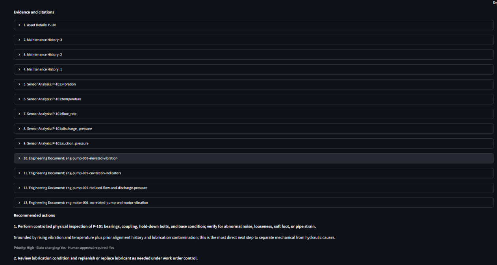
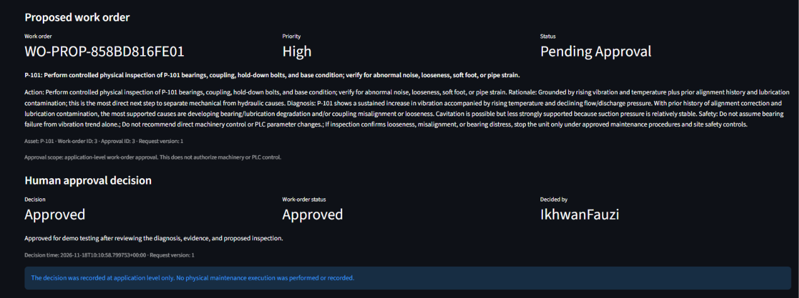
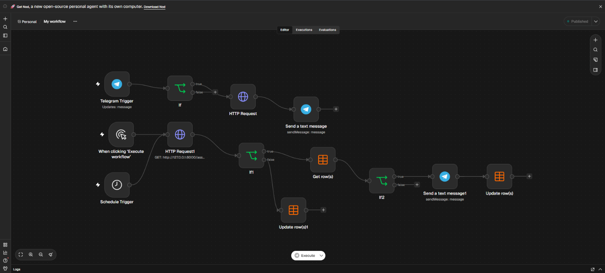
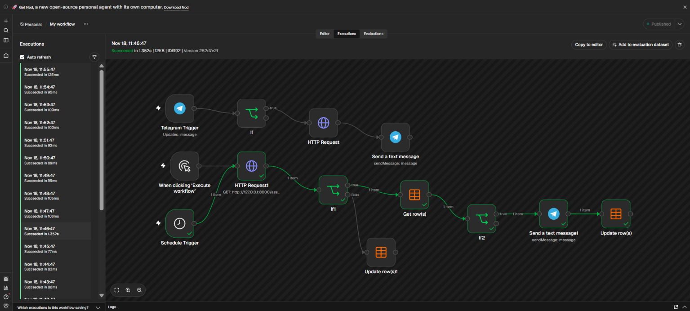
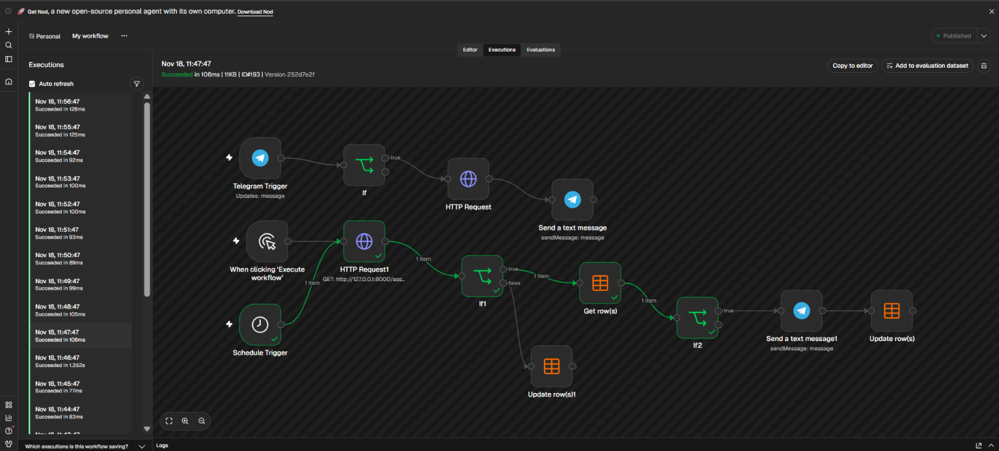
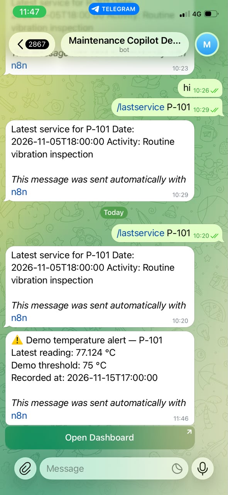
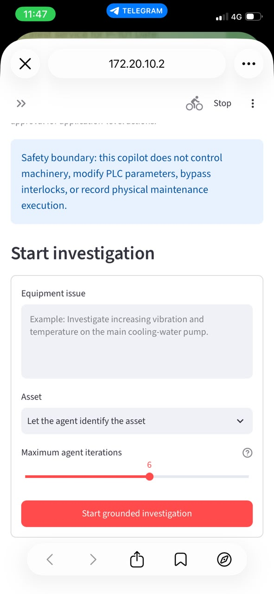
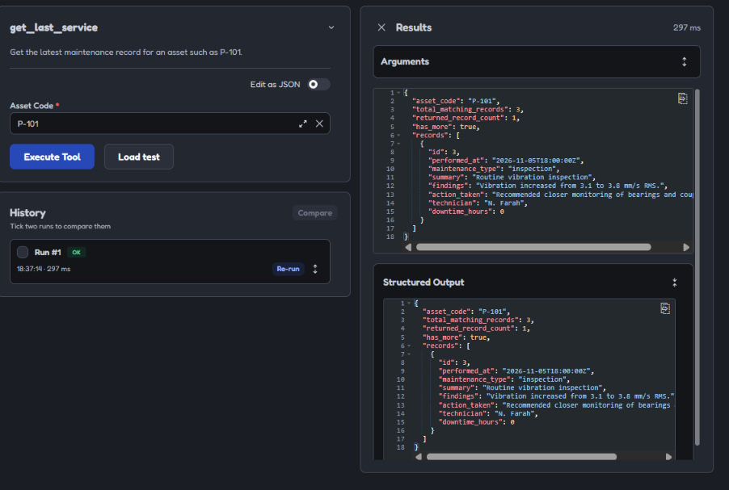

# Local Demo Guide

## Demonstration scope

This guide demonstrates the local Docker application using PostgreSQL and pgvector,
with a hosted Azure OpenAI model for investigation.

n8n and the MCP server run separately on the laptop.

The sensor readings and engineering documents are synthetic demonstration data.
Human approval changes application records only; it does not perform physical
maintenance or control machinery.

Commands below use Windows Anaconda Prompt from the repository root.

## Prerequisites

- Docker Desktop running with its Linux engine.
- `.env` configured from `.env.example`.
- A matching PostgreSQL password in the local connection settings.
- Valid Azure OpenAI settings for live investigation.
- The `MaintenanceCopilot` Python environment for local tools and tests.
- Node.js/npm and ngrok for the optional integration demonstrations.
- Telegram credentials and the configured n8n workflow for the bot demonstration.

Do not replace an existing working `.env` with the example file.

## 1. Start the application stack

### Fresh database

For a fresh setup, the API initializer applies migrations, seeds demonstration
records, and indexes the engineering documents.

```bat
docker compose up --build -d --wait --wait-timeout 600
docker compose ps
```

Expected services:

- `postgres`: healthy
- `api`: healthy
- `dashboard`: healthy

The first startup can take longer while downloading the embedding model.

### Existing database with investigation records

The current seed initializer requires exact demonstration record counts.
Additional work orders or approvals can cause it to reject the database during
a later startup.

For an already initialized database containing investigation results, change only
the API setting in `compose.yaml` to:

```yaml
INITIALIZE_APPLICATION_DATA: "false"
```

Then start the stack:

```bat
docker compose up -d --wait --wait-timeout 600
```

This preserves application records and skips the initializer. Apply migrations
and indexing explicitly when required.

Do not reset volumes or delete valid work orders to satisfy seed counts.
See [PostgreSQL and pgvector](postgresql-pgvector.md) for details.

### Avoid port conflicts

Stop a separately running local Uvicorn or Streamlit process before starting the
Docker services. Do not run a second API on port 8000.

## 2. Verify maintenance endpoints

```bat
curl.exe -i http://127.0.0.1:8000/assets/P-101/latest-temperature
curl.exe -i http://127.0.0.1:8000/assets/P-101/last-service
```

Expected: HTTP 200 from both endpoints.

At the migrated demonstration checkpoint:

| Field | Value |
|---|---|
| Asset | `P-101` |
| Latest temperature reading ID | `837` |
| Temperature | `77.124 degC` |
| Temperature timestamp | `2026-11-15T17:00:00Z` |
| Latest maintenance record ID | `3` |
| Maintenance summary | `Routine vibration inspection` |

A fresh seed uses a new reference time, so timestamps can differ.

These lookup requests do not invoke Azure OpenAI.

## 3. Run a grounded investigation

Open the [local dashboard](http://localhost:8501/).

Dashboard settings:

| Setting | Value |
|---|---|
| API URL | `http://api:8000` |
| Request timeout | `120` seconds |
| Asset | `P-101` |
| Maximum iterations | `6` |

The dashboard runs inside Compose, so its API hostname is `api`.

Use this issue description:

```text
Investigate increasing vibration on P-101. Gather asset details,
maintenance history, sensor analysis, and engineering guidance
before giving a grounded assessment.
```

Select **Start grounded investigation**.

This step invokes the configured hosted model and can consume billable tokens.
Exact wording, tool selection, timing, and proposal behavior can vary between runs.

Review:

- Investigation status.
- Diagnosis outcome and confidence.
- Supporting evidence and citations.
- Missing evidence and uncertainty.
- Recommended actions.
- Proposed work order, if one is created.

The demonstrated run collected all four evidence categories and displayed
13 evidence references. This is an observed run result, not a guaranteed citation
count for every execution.

### Diagnosis



### Evidence and citations



## 4. Review and record a human decision

If the investigation proposes a work order, review its action, rationale, asset,
priority, and evidence before making a decision.

Example demonstration input:

```text
Operator: Demo Operator
Reason: Approved for demo testing after reviewing the diagnosis,
evidence, and proposed inspection.
```

Choose **Approve work order** or **Reject work order** as appropriate.

The demonstrated local run recorded an approved decision and an approved
work-order status in PostgreSQL.



### Inspect persisted decisions

```bat
docker compose exec postgres psql -U maintenance -d maintenance_copilot -x -c "SELECT a.id AS approval_id, w.work_order_number, a.decision, a.decided_by, a.decided_at, a.decision_reason, w.status AS work_order_status FROM approvals a JOIN work_orders w ON w.id = a.work_order_id ORDER BY a.id DESC LIMIT 5;"
```

Work-order IDs, approval IDs, and maintenance-record IDs belong to different
tables. Approving a work order does not create a completed maintenance record.

### Known display issue

The proposed-work-order panel can retain its original pending status after a
decision. The local demonstration confirmed the approved decision and current
work-order status directly in PostgreSQL.

An old banner also refers to approval controls as a future feature even though
the controls are available.

Do not repeatedly submit a decision to resolve a display mismatch.
Inspect the recorded decision and database state.

## 5. Demonstrate Telegram maintenance lookup

Start ngrok in a separate terminal:

```bat
ngrok http 5678
```

Start n8n in another terminal. Replace the tunnel placeholder with the current
HTTPS forwarding address:

```bat
set "NODE_OPTIONS=--dns-result-order=ipv4first"
set "N8N_WEBHOOK_URL=https://YOUR-TUNNEL-DOMAIN/"
set "N8N_PROXY_HOPS=1"
npx n8n
```

Open [n8n](http://localhost:5678/), verify the configured Telegram credentials,
and publish the workflow.

Send to the configured bot:

```text
/lastservice P-101
```

Expected: the bot returns the latest maintenance record.

The demonstrated n8n instance runs on the laptop. Its HTTP Request nodes use
`http://127.0.0.1:8000` to reach the published Docker API port.

See [Integration details](integrations.md) for topology and configuration.

## 6. Demonstrate the temperature alert

Confirm that the n8n Data Table `temperature_alert_state` has a `P-101` row.

For a controlled demonstration:

1. Pause or deactivate the Schedule Trigger while preparing the state.
2. Set `is_above_threshold` to Boolean false.
3. Confirm the threshold condition is `value > 75`.
4. Execute the workflow from its Manual Trigger.
5. Confirm one Telegram alert is received.
6. Execute the same manual path again without resetting the state.
7. Confirm the second run suppresses the Telegram message.
8. Restore the Schedule Trigger if scheduled monitoring is desired, and publish
   the intended final workflow version.

The migrated P-101 temperature exceeds the demonstration threshold.

### Workflow structure



### Alert sent



### Repeated alert suppressed



### Telegram message and dashboard button



These alert screenshots show the earlier integration demonstration.
Maintenance lookup was subsequently rechecked against the PostgreSQL-backed
Docker API.

The workflow reads historical demo data and does not currently reject stale
timestamps. The threshold is not an equipment safety limit.

## 7. Open the dashboard from a phone

The phone must be able to reach the laptop on the selected network.

Configure the Telegram inline button with:

```text
http://LAPTOP-REACHABLE-IP:8501
```

Do not use `localhost` as the phone's dashboard address.

In the demonstrated setup, the laptop connected to the phone's personal hotspot.
The phone opened the dashboard using the laptop's hotspot address.



The address can change when reconnecting or switching networks. A local IP button
is not a public deployment link.

## 8. Demonstrate the MCP tool

With the Docker API running, open another terminal:

```bat
conda activate MaintenanceCopilot
npx @modelcontextprotocol/inspector
```

Launch from the repository root.

Configure the MCP server:

| Setting | Value |
|---|---|
| Transport | STDIO |
| Command | `python` |
| Arguments | `-m app.mcp_server` |

Connect the server, open Tools, and execute:

```text
Tool: get_last_service
Asset code: P-101
```

Expected: structured maintenance data with the latest record.



This tool calls FastAPI and does not invoke the hosted diagnosis model.

## 9. Verify the test suite

With local Python dependencies installed and PostgreSQL running, create the
test database once if it does not already exist:

```bat
docker compose exec postgres psql -U maintenance -d postgres -c "CREATE DATABASE maintenance_copilot_test;"
```

Run:

```bat
python -m ruff format --check .
python -m ruff check .
python -m pip check
python -m alembic check
set "RUN_POSTGRES_TESTS=1"
python -m pytest -q
set "RUN_POSTGRES_TESTS="
```

The recorded local validation completed with **536 tests passed**, including
five PostgreSQL/pgvector integration tests.

With the integration flag unset, those five tests are skipped.

Automated tests use deterministic or mocked model behavior and do not make
billable Azure model calls.

## 10. Stop the demonstration

Stop n8n, ngrok, and MCP Inspector with Ctrl+C in their respective terminals.

Stop Docker services while retaining data:

```bat
docker compose stop
```

Named volumes retain PostgreSQL data and local container checkpoint/cache data.
Follow the existing-database startup instructions when resuming.

Avoid removing volumes unless intentionally deleting persisted demonstration data.

## Troubleshooting

| Symptom | Check |
|---|---|
| Port 8000 is already in use | Stop the separate local API process |
| API fails during seed validation | Existing data may exceed exact seed counts; use the documented initialized-database startup path |
| PostgreSQL password authentication fails | Check the actual role password and matching local/Compose settings |
| Telegram does not reply | Check command spelling, chat restriction, published workflow, n8n, and tunnel |
| Alert reaches the false branch | Check both the temperature condition and stored alert state |
| No state row is returned | Create the required asset row in the n8n Data Table |
| MCP cannot retrieve data | Confirm the API is running and the MCP Python process uses the project environment |
| Phone cannot open the dashboard | Check reachable laptop IP, port, network isolation, and firewall |
| Proposed status remains pending | Compare the recorded decision with PostgreSQL; see the known display issue |
| Hugging Face reports an unauthenticated warning | Check whether model loading actually completed; successful loading can proceed without a token |

## Historical Azure evidence

The original V8.4 Azure deployment used SQLite application data and Chroma.
Its screenshots are retained as historical deployment evidence:

- [Hosted approval](assets/hosted-hitl-approval.png)
- [Hosted completion](assets/hosted-investigation-completed.png)
- [Earlier GitHub Actions result](assets/final-ci-green.png)

The current PostgreSQL/pgvector stack was verified locally through Docker.
The updated Azure template has not been redeployed with an external PostgreSQL
service.